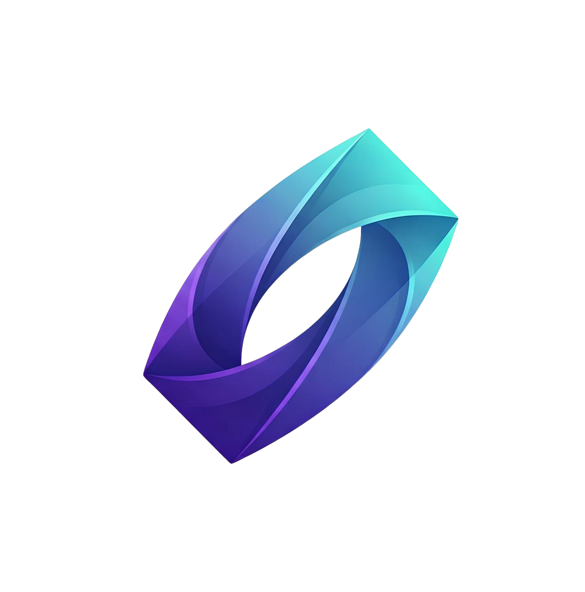

<p align="center">
  
</p>

# Noesis

> **Predicting the unpredictable. Accelerating breakthroughs through autonomous, agent-driven discovery loops.**

**Meta Global AI Developer Hackathon — Indie track build by Team EigenBrains.**
Its agents run on Meta's **Muse Code** harness against the **Meta Model API**.


---

## ▶️ Run it (Meta indie track)

Full commands, evidence paths and limitations: [`docs/hackathon/DEMO.md`](docs/hackathon/DEMO.md).

You need Python 3.12, Node 22, the [Muse Code CLI](https://dev.meta.ai/docs/muse-code) and a
Meta Model API key in Standard mode. Keep the key in a file **outside the repository**.

```powershell
$env:MODEL_API_KEY_FILE = "C:\path\outside\repo\meta_api_key.txt"

# terminal 1: lab bridge (agents, MCP tools, ledger); --enable-runs allows starting runs
cd discolab; python -m venv .venv; .venv\Scripts\pip install -e ".[dev]"
.venv\Scripts\python -m discolab.bridge --enable-runs --port 8765

# terminal 2: web app
cd frontend; npm ci; npx vite dev --port 5173
```

Open `http://localhost:5173`, type a research question and press Enter.

**What it does, and what it does not:**
- **Any research question is accepted.** Muse Spark classifies it.
  - **Lab mode.** Questions about population entropy as an early warning of
    GA stagnation run real, seeded GA experiments with pre-registered
    statistics and Bayesian updates.
  - **Open-research mode.** Every other question gets literature, competing
    hypotheses, study protocols and critique. It **proposes studies but
    executes none**: no experiment is run or simulated, and its hypotheses
    stay `untested`.
- **Escalation.** Spark 1.3 specialists hand off to a Wonder 1.0 verifier when
  the frozen Noesis gate escalates. The critic records its analysis *before*
  verification; the UI shows each analysis as unverified, confirmed,
  corrected or rejected.
- **Benchmark.** The held-out benchmark did **not** show an escalation quality
  gain. All S0–S4 policies scored 0.833 on the 12 held-out cases, with 0
  provider-backed rescues. Every paired difference is unresolved at 95%.
  Escalation is a safety mechanism here, not a measured improvement. See
  [`benchmark/reports/MUSE_AGENTS_BASELINE_V1.md`](benchmark/reports/MUSE_AGENTS_BASELINE_V1.md).
- **Evidence.** Sources are identity-checked against OpenAlex/arXiv. Each
  claim is an agent's summary and is not checked against the paper.
- **Spend.** Spend is estimated from tokens, and the per-run limit is a
  **soft guard**, not a hard cap: agents already running can exceed it.
- **Deployment.** The `/lab-proxy` relay only reaches bridges listed in
  `NOESIS_LAB_ORIGINS` (dev default: `http://127.0.0.1:8765`) and refuses
  redirects. A hosted (production) app is **read-only** unless the server sets
  `NOESIS_LAB_WRITE_TOKEN`. With it set, an operator types that token once in
  the app to unlock runs. The server then sets a signed HttpOnly session
  cookie (8 h); the token is never in the frontend bundle or page storage.
  Without the token, hosted visitors explore recorded runs, and new runs start
  from a local lab.

---

## 🚀 The Moonshot

**What if an AI laboratory could discover when an optimization algorithm is about to fail — and intervene before it actually does?**

**Noesis** is an autonomous AI laboratory designed to accelerate scientific discovery by turning the traditional scientific method into a continuous, agent-driven discovery loop.

Instead of relying on a researcher to manually:

1. inspect results,
2. formulate hypotheses,
3. design experiments,
4. run simulations,
5. analyze outcomes, and
6. decide what to test next,

Noesis delegates these steps to specialized AI agents running on Meta's **Muse Code** (Meta Model API).

The result is a closed-loop research system:

```text
        ┌───────────────────────┐
        │   Scientific Insight  │
        │      & Hypothesis     │
        └───────────┬───────────┘
                    ↓
        ┌───────────────────────┐
        │   Experiment Planner  │
        └───────────┬───────────┘
                    ↓
        ┌───────────────────────┐
        │    Experiment Runner  │
        │   Simulations / Data  │
        └───────────┬───────────┘
                    ↓
        ┌───────────────────────┐
        │    Analysis Agent     │
        │ Evidence & Evaluation │
        └───────────┬───────────┘
                    │
                    └──────────────► New Hypothesis
```

**Hypothesis → Experiment → Evidence → Insight → New Hypothesis**

This transforms Noesis from a simple AI assistant into an **autonomous discovery loop**.

---

# 🔬 Our Scientific Question

We focus on a fundamental problem in evolutionary and population-based optimization:

> **Can the dynamics of population entropy predict an impending search collapse before fitness stagnation becomes obvious — and can that early-warning signal trigger an intervention that recovers the optimum faster on unseen and dynamically shifting landscapes?**

Population-based optimization algorithms can gradually lose diversity.

When this happens:

```text
High Diversity
      │
      ▼
Exploration
      │
      ▼
Population Convergence
      │
      ▼
Entropy Collapse
      │
      ▼
Search Becomes Trapped
      │
      ▼
Fitness Stagnation
```

The key idea behind Noesis is simple:

> **Fitness stagnation may be a symptom. Population entropy collapse may be an early warning signal.**

If entropy can reliably identify an approaching search collapse **before** fitness stagnates, an autonomous agent could intervene early and redirect the search.

---

# 🎯 The Noesis Hypothesis

We hypothesize that:

> **A significant decline in population entropy precedes observable fitness stagnation and can therefore serve as an early-warning signal for optimization collapse.**

Noesis attempts to learn:

* when population diversity becomes dangerously low,
* whether an entropy threshold generalizes across landscapes,
* how early the collapse can be detected,
* which intervention is most effective,
* and whether predictive intervention improves recovery time on unseen and dynamically shifting landscapes.

The ultimate objective is not simply to find a better solution.

It is to **discover the conditions under which the search itself is about to fail — and correct it autonomously.**

---

# 🧪 From Manual Optimization to Autonomous Discovery

### Traditional workflow

```text
Researcher
    │
    ├── Inspect results
    ├── Form hypothesis
    ├── Design experiment
    ├── Run simulation
    ├── Analyze results
    └── Repeat
```

### Noesis

```text
┌──────────────────────────────────────────────────────┐
│                    NOESIS LAB                        │
│                                                      │
│  Insight → Plan → Experiment → Analysis → Insight   │
│     ▲                                      │         │
│     └──────────────────────────────────────┘         │
│                                                      │
└──────────────────────────────────────────────────────┘
```

The researcher defines the scientific objective.

**Noesis manages the discovery loop.**

---

# 🧠 Agentic Orchestration

Noesis uses specialized agents rather than asking a single model to perform the entire research process.

All agents collaborate through a **shared research record**, allowing experimental evidence to influence subsequent decisions.

## 1. 🔎 Insight Agent

The scientific reasoning layer.

Responsibilities:

* analyzes previous experimental evidence,
* identifies patterns,
* proposes testable hypotheses,
* estimates the entropy threshold associated with collapse,
* proposes candidate interventions.

**Output:** a falsifiable scientific hypothesis.

---

## 2. 🧭 Experiment Planner

The experimental-design layer.

Responsibilities:

* translates hypotheses into experiments,
* selects appropriate benchmark landscapes,
* chooses parameter configurations,
* introduces dynamically shifting environments,
* prioritizes experiments that provide the most informative evidence.

**Output:** a structured experimental plan.

---

## 3. ⚙️ Experiment Runner

The execution layer.

Responsibilities:

* executes Python simulations,
* runs baseline optimization,
* runs the predictive intervention strategy,
* maintains matched experimental conditions,
* records population entropy and fitness dynamics.

**Output:** reproducible experimental data.

---

## 4. 📊 Analysis Agent

The evidence layer.

Responsibilities:

* evaluates experimental outcomes,
* compares baseline and intervention strategies,
* measures recovery time,
* identifies successful and failed interventions,
* extracts evidence for the next research cycle.

**Output:** structured evidence and updated research context.

---

# 🔁 The Autonomous Discovery Loop

```text
                    ┌─────────────────┐
                    │  Insight Agent  │
                    │   Hypothesis    │
                    └────────┬────────┘
                             │
                             ▼
                    ┌─────────────────┐
                    │ Experiment      │
                    │ Planner         │
                    └────────┬────────┘
                             │
                             ▼
                    ┌─────────────────┐
                    │ Experiment      │
                    │ Runner          │
                    └────────┬────────┘
                             │
                             ▼
                    ┌─────────────────┐
                    │ Analysis Agent  │
                    │    Evidence     │
                    └────────┬────────┘
                             │
                             ▼
                    ┌─────────────────┐
                    │ Updated Research│
                    │     Record      │
                    └────────┬────────┘
                             │
                             └──────────────► Insight Agent
```

Each cycle makes the next experiment more informed by the evidence collected previously.

---

# 📈 What We Measure

Noesis evaluates discovery acceleration through measurable optimization dynamics.

### Population-level signals

* **Population entropy**
* Population diversity
* Convergence dynamics
* Search-space coverage

### Optimization performance

* Best fitness
* Fitness stagnation
* Time to recovery
* Time to optimum / near-optimum
* Performance degradation after landscape shifts

### Scientific discovery metrics

* Hypothesis success rate
* Number of experiments required
* Experimental efficiency
* Generalization to unseen landscapes
* Improvement over the baseline strategy

The central comparison is:

```text
                    Optimization Performance

Baseline       ────────────────────────────────╮
                                                │
                                                │ stagnation
                                                ▼
Predictive     ────────────────╮
Intervention                   │ early warning
                               ▼
                         Intervention
                               │
                               ▼
                         Search Recovery
```

---

# 🌍 Dynamic Benchmark Landscapes

To avoid overfitting the discovery to a single static environment, Noesis evaluates its hypothesis across mathematical optimization landscapes, including dynamically shifting variants of:

* **Ackley**
* **Rastrigin**
* other configurable benchmark environments

The objective is to determine whether the learned warning signal remains useful when the search environment changes.

A successful discovery therefore needs to demonstrate more than:

> "This threshold works on one benchmark."

It should answer:

> **"Does this phenomenon generalize?"**

---

# 🏗️ Project Architecture

The repository separates the autonomous orchestration layer, scientific simulation environment, frontend visualization, and experimental evidence.

```text
.
├── backend/
│   ├── app/
│   │   ├── agents/
│   │   ├── tools/
│   │   └── ...
│   ├── benchmarks/
│   ├── tests/
│   ├── EXPERIMENTS.md
│   └── pytest.ini
│
├── frontend/
│   ├── src/
│   ├── public/
│   └── ...
│
├── benchmark/
│   ├── cases/
│   ├── configs/
│   ├── artifacts/
│   └── reports/
│
├── docs/
│   ├── API_CONTRACTS.md
│   └── BENCHMARK_METHODOLOGY.md
│
├── .env.example
└── README.md
```

## `backend/`

The Python engine powering the autonomous laboratory.

### `app/`

Core application logic, Omnigent orchestration, agent definitions, and research tools.

### `benchmarks/`

Simulation and optimization benchmark implementations.

### `EXPERIMENTS.md`

A living research log containing the experiments conducted by the autonomous discovery loop.

### `tests/`

Automated tests ensuring backend reliability and reproducibility.

---

## `frontend/`

Interactive dashboard built with:

* **Vite**
* **React**
* **TypeScript**

The interface provides a real-time window into the scientific process, including:

* agent handoffs,
* experiment status,
* population entropy,
* fitness evolution,
* recovery metrics,
* research-loop progression.

---

## `benchmark/`

Scientific evaluation environment.

### `cases/`

Benchmark landscapes and experimental scenarios.

### `configs/`

Experiment configurations and parameter definitions.

### `artifacts/`

Raw and structured outputs generated by experiments.

### `reports/`

Processed experimental results and analysis.

---

## `docs/`

System and methodology documentation.

### `API_CONTRACTS.md`

Defines communication interfaces between the frontend and backend.

### `BENCHMARK_METHODOLOGY.md`

Documents the mathematical framework, evaluation methodology, and metrics used to measure discovery acceleration.

---

# 🛠️ Getting Started

## 1. Clone the repository

```bash
git clone https://github.com/Ismailea4/Agentic-Scientific-Discovery-EigenBrains.git

cd Agentic-Scientific-Discovery-EigenBrains
```

## 2. Run the Meta indie-track build

Follow [Run it (Meta indie track)](#-run-it-meta-indie-track) above, or
[`docs/hackathon/DEMO.md`](docs/hackathon/DEMO.md) for the full version. Point
`MODEL_API_KEY_FILE` at a key file outside the repository.

> **Never commit API keys or secrets to the repository.**

The sections below cover the older **core API** (FastAPI backend). It is
optional: Muse lab runs do not use it, and the top bar reports it separately
from the lab bridge.

---

## 3. Optional: set up and start the older core API

```bash
cd backend

python -m venv .venv
```

### Linux / macOS

```bash
source .venv/bin/activate
```

### Windows

```powershell
.venv\Scripts\activate
```

Install dependencies:

```bash
python -m pip install -r requirements.txt
```

Start the FastAPI backend:

```bash
python -m uvicorn app.main:app --reload --port 8000
```

Keep this terminal running. The backend health endpoint is
`http://localhost:8000/health`.

---

## 4. Start the frontend

Open a second terminal at the repository root and run:

```bash
cd frontend

npm install
npm run dev
```

Vite will print the exact local URL. It is normally
`http://localhost:5173`.

Open that URL in your browser. The top bar shows two separate statuses:
- **Lab bridge** (required for runs): connected, offline or not configured;
- **Core API (optional)**: the older FastAPI backend on port 8000.

---

## 5. Read-only lab bridge (recorded results only)

Without `--enable-runs`, the lab bridge is read-only. You can browse
recorded runs under `discolab/results/` and `discolab/lab_home/`, but you
can't start new ones.

Open a third terminal at the repository root and install the local
`discolab` package once:

```bash
cd discolab
python -m pip install -e .
```

Then start the bridge from the `discolab` directory:

```bash
python -m discolab.bridge --port 8765
```

Verify that it is serving the recorded sources by opening
`http://127.0.0.1:8765/lab/sources`. The committed sources include:

- `results/run1_prereg_v1`
- `results/run2_prereg_v2`

The bridge reads these files and writes nothing. To stop it, press
`Ctrl+C` in its terminal.

---

# 🧬 Why Noesis?

Most optimization systems focus on answering:

> **"What is the best solution?"**

Noesis asks a different question:

> **"Can we predict when our search process is about to stop finding better solutions?"**

That distinction is fundamental.

Instead of waiting for an optimization algorithm to fail, Noesis attempts to identify the **precursors of failure** and use them to trigger autonomous intervention.

This creates a new feedback loop:

```text
Optimization
     ↓
Observe Search Dynamics
     ↓
Detect Early Warning Signal
     ↓
Predict Collapse
     ↓
Intervene
     ↓
Recover Search
     ↓
Learn From Evidence
     ↓
Improve Next Experiment
```

---

# ⚡ Toward 10× Faster Scientific Discovery

Noesis does not define "10× faster" simply as making one simulation execute ten times faster.

Instead, we target the **scientific discovery process itself**.

The long-term vision is to reduce the number of human-driven iterations required to move from:

```text
Question
   ↓
Hypothesis
   ↓
Experiment
   ↓
Evidence
   ↓
New Hypothesis
```

to a system where this loop can operate continuously and autonomously.

### The ambition

**10× more experiments.**
**10× faster hypothesis iteration.**
**10× less manual scientific orchestration.**

Not by removing scientists from the loop—

**but by giving them an autonomous laboratory capable of exploring the space between their questions.**

---

# 🧪 Research Status

Noesis is currently focused on validating the core hypothesis around **population entropy as an early-warning signal for optimization collapse**.

The experimental loop is designed to progressively answer:

| Question                                          | Goal                       |
| ------------------------------------------------- | -------------------------- |
| Does entropy collapse precede fitness stagnation? | Validate the signal        |
| Is there a measurable tipping point?              | Identify the threshold     |
| Can an intervention exploit the signal?           | Validate causality         |
| Does it improve recovery time?                    | Measure acceleration       |
| Does it generalize across landscapes?             | Test robustness            |
| Can agents discover this autonomously?            | Validate the research loop |

---

# 👥 Team EigenBrains

**Noesis** is developed by **Team EigenBrains**. This build is our **Meta Global AI Developer Hackathon (Indie track)** submission.

### Core technologies

`Python` · `React` · `TypeScript` · `Vite` · `Meta Muse Code` · `Meta Model API` · `MCP` · `AI Agents` · `Optimization` · `Scientific Computing`

---

# 📚 Documentation

For deeper technical details:

* [`EXPERIMENTS.md`](backend/EXPERIMENTS.md) — Autonomous experiment history
* [`BENCHMARK_METHODOLOGY.md`](docs/BENCHMARK_METHODOLOGY.md) — Evaluation methodology
* [`API_CONTRACTS.md`](docs/API_CONTRACTS.md) — Frontend/backend interfaces

---

# 🔭 The Vision

Scientific discovery is fundamentally a search problem.

The search space is enormous.
Experiments are expensive.
Human attention is limited.

Noesis explores a future where AI does not merely **answer scientific questions**.

It learns how to **ask better questions, design better experiments, interpret evidence, and decide what to investigate next.**

> **Noesis doesn't replace the scientific method.**
>
> **It puts the scientific method on an autonomous loop.**

---

**Built by Team EigenBrains · Meta Global AI Developer Hackathon, Indie track**
