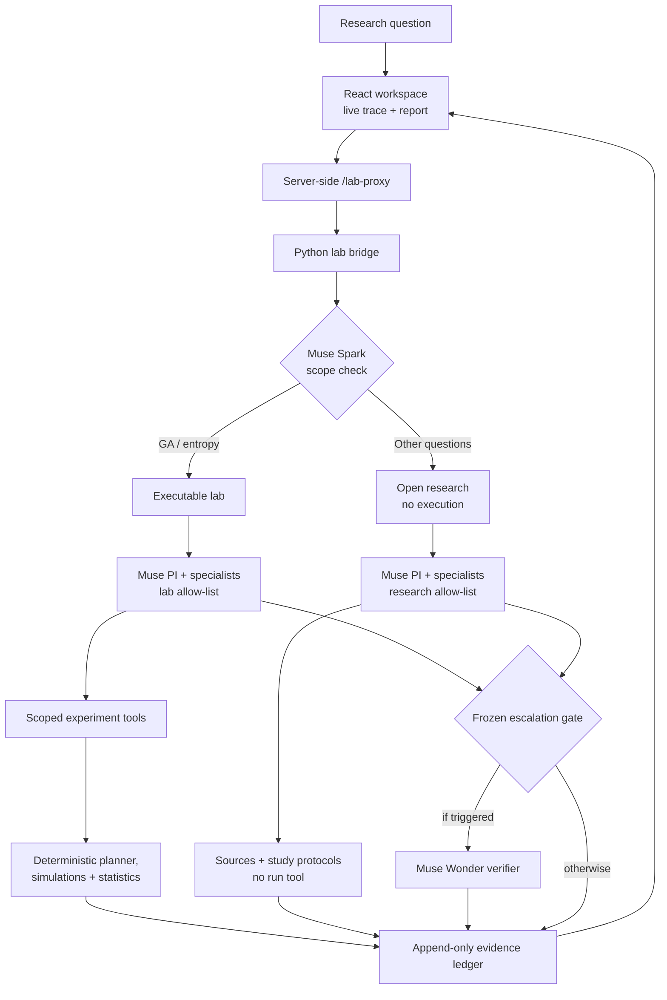
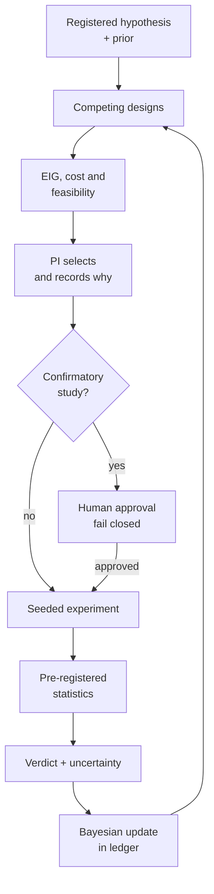

<p align="center">
  
</p>

# Noesis

<p align="center"><strong>Ask a research question. Watch agents design the next test. Inspect the evidence behind their decision.</strong></p>

<p align="center">Team EigenBrains · Meta Global AI Developer Hackathon · Indie track</p>

[](https://github.com/coderyaz856/NOESIS-Autonomous-Information-Driven-Scientific-Discovery/actions/workflows/tests.yml?query=branch%3Amain)
[](https://crates.io/crates/noesis-discovery)
[](https://github.com/coderyaz856/NOESIS-Autonomous-Information-Driven-Scientific-Discovery/releases/tag/sdk-v0.1.0)
[](LICENSE.md)
[](deploy/huggingface/README.md)


[Try the live app](https://noesis-agent.lovable.app/) · [Watch the demo](https://www.youtube.com/watch?v=x3rVdGG7zP4) · [Read the measured results](#three-results-worth-inspecting) · [Use the three-language SDK](#research-sdk) · [Browse all documentation](docs/README.md) · [Run it locally (optional)](docs/hackathon/DEMO.md)

**Start here:** try the [live app](https://noesis-agent.lovable.app/) and ask a research question; watch the [3-minute demo video](https://www.youtube.com/watch?v=x3rVdGG7zP4); inspect a [recorded run](discolab/results/recorded-open-question/run.json) and the [sealed scientific result](docs/SEALED_ENTROPY_EARLY_WARNING_RESULT.md). Optional: run the [read-only local demo](#try-it-locally) without a key, or the offline [cross-language interoperability proof](#research-sdk). A live Muse run incurs API charges.

## What happens when you ask a question

Noesis is an evidence-centered research workspace. A principal-investigator (PI) agent delegates literature review, experiment design, and critique to specialists running in **Meta Muse Code** on the **Meta Model API**. The PI makes and records the next research choice; scoped tools, not language-model prose, calculate measurements and enforce study rules. The interface streams handoffs, tool activity, uncertainty, and the final report.

There are two deliberately different modes:

| Mode | What the agents do | What the result means |
|---|---|---|
| **Scientific lab** | For the pre-registered genetic-algorithm/entropy question, agents can select and run seeded simulations, analyze the outputs, update beliefs, and choose the next experiment. Confirmatory work requires human approval. | An executed experiment with a ledger, numerical artifacts, and stated uncertainty. |
| **Open research** | For other questions, agents retrieve identifiable sources, propose competing falsifiable hypotheses, draft study protocols, critique them, and recommend a next study. | A research plan. **No experiment is executed or simulated; hypotheses remain untested.** |

The [demo guide](docs/hackathon/DEMO.md) explains both modes, the approval gate, the Muse verifier, costs, and the limits of source checking. A [recorded open-research run](discolab/results/recorded-open-question/run.json) is included for inspection without a paid model call.

### One coherent system, two honest outcomes



In **open research**, the tool boundary blocks the simulation path; agents can propose protocols but cannot manufacture experimental results. In **lab mode**, a pre-registered numerical result updates the ledger and the next decision. The Wonder gate may verify a specialist report, but the benchmark does not establish that this improves accuracy.

## Three results worth inspecting

**1. Selective experimentation reduced measured simulation work.** Across five development-stage replicates and seven hypotheses, the fixed 24-seed design consumed **1.54×** the simulated generations of the frozen 6 → 12 → 24-seed escalation policy (95% interval **1.28–1.90×**). Escalation agreed with a separate 48-seed reference in **28/35** hypothesis-replicates; the fixed design agreed in **29/35**. This is roughly **35% less compute**, **not** 1.54× faster wall-clock research or evidence of held-out generalization. [Protocol, raw summary, and limitations](discolab/results/escalation/README.md).

**2. A sealed test overturned the attractive development result.** Adding entropy to fitness history raised development AUROC by **+0.1393**, but its pre-registered held-out contrast was **−0.00588** (95% paired cluster-bootstrap interval **[−0.01108, −0.00031]**). The registered verdict was **`no_meaningful_gain`** against a +0.02 smallest effect of interest. The conclusion is landscape-dependent: the evidence does **not** show that entropy is universally harmful or useless. [Sealed study, protocol, and independent Julia check](docs/SEALED_ENTROPY_EARLY_WARNING_RESULT.md).

**3. A second Muse agent did not earn a quality claim.** On 12 held-out benchmark cases, Spark 1.3 alone, always-both, and Spark → selective Wonder each scored **0.833**. Selective escalation used **38.0% less estimated cost** and **24.9% less latency** than always-both in **offline replay**; six actual verifier calls produced **zero rescues and zero damage**. Spark-only was the empirical cost/quality frontier on this corpus, and all paired quality differences remain unresolved at 95%. Replay savings are **not** a provider-backed architecture speed-up. [Frozen Muse-agent benchmark](benchmark/reports/MUSE_AGENTS_BASELINE_V1.md).

These are three distinct evaluations; their speed and cost ratios must not be multiplied into a single “research acceleration” claim. Raw observations, frozen protocols, and limitations are linked from each report. See also the [benchmark methodology](docs/BENCHMARK_METHODOLOGY.md) and [reproducibility handbook](docs/REPRODUCIBILITY.md).

## Why the decision engine matters

Noesis treats agents and experiments as **allocations of limited research resources**, not a fixed chain of model calls. The same principle operates at three levels:

| Decision | Evidence used | Implemented consequence |
|---|---|---|
| **Which agent earns a second call?** | Paired task losses, failure covariance, availability, cost, latency, and uncertainty. | The benchmark/control plane computes empirical and robust Pareto comparisons. The live Muse lab uses a **frozen** Spark → Wonder escalation gate; it does **not** self-rewrite its agent graph. |
| **Which experiment is worth running?** | A declared likelihood table for supported / inconclusive / refuted verdicts, expected information gain (EIG), estimated wall time, held-out-data cost, and feasibility constraints. | The deterministic planner ranks feasible competing designs. The PI selects and records its reason; only the PI can spend compute. |
| **What should be believed next?** | A real experiment's pre-registered numerical verdict and the same likelihood model used by the planner. | A Bayesian posterior update changes the ledger state, so the next candidate set can be rescored. An unexecuted open-research proposal cannot update evidence. |

For a candidate experiment `E`, the planner's declared utility is `U(E) = EIG(E) − η·wall_seconds(E) − λ·held_out_landscapes(E)`, **after** hard constraints. EIG is the expected reduction in binary-hypothesis entropy, in bits; it is a model-based estimate, not a measured discovery. Portfolio analysis similarly checks whether a second agent's *marginal* value survives correlated failures and its additional cost.



The numerical layer uses controlled random streams, paired bootstrap intervals, Wilson intervals, McNemar comparisons, and censoring-aware recovery analysis where applicable. The full equations and assumptions are in [Financial mathematics and the meta-agent](docs/FINANCIAL_MATH_AND_META_AGENT.md); the operating safeguards are in [Scientific rigor](docs/SCIENTIFIC_RIGOR.md) and [system architecture](docs/SYSTEM_ARCHITECTURE.md).

## Try it locally

You need **Python 3.12**, **Node.js 22**, and, for live agent runs, the [Muse Code CLI](https://dev.meta.ai/docs/muse-code) plus a Meta Model API key in Standard mode. The commands below are for PowerShell; the [demo guide](docs/hackathon/DEMO.md) has the full operating notes. Clone this repository, then open two terminals at its root:

```powershell
git clone https://github.com/coderyaz856/NOESIS-Autonomous-Information-Driven-Scientific-Discovery.git
Set-Location .\NOESIS-Autonomous-Information-Driven-Scientific-Discovery
```

**Terminal 1 — lab bridge:**

```powershell
Set-Location .\discolab
py -3.12 -m venv .venv
.\.venv\Scripts\python.exe -m pip install -e ".[dev]"
.\.venv\Scripts\python.exe -m discolab.bridge --port 8765
```

This starts in **read-only mode**: browse recorded runs without a model key. To start a **live** lab, point `MODEL_API_KEY_FILE` to a key file **outside the repository** and restart the bridge with `--enable-runs`:

```powershell
$env:MODEL_API_KEY_FILE = "C:\path\outside\repo\meta_api_key.txt"
.\.venv\Scripts\python.exe -m discolab.bridge --enable-runs --port 8765
```

**Terminal 2 — browser app (from the repository root):**

```powershell
Set-Location .\frontend
npm ci
npm run dev -- --port 5173
```

Open **http://localhost:5173**. Ask about entropy as an early warning of GA stagnation to enter the executable lab; another research question enters open-research mode. Live Muse calls incur charges, and the per-run spend guard is **soft**, not a billing cap.

For a hosted installation, the browser app and authenticated Python bridge are separate services. The [Hugging Face deployment guide](deploy/huggingface/README.md) explains the bridge, persistent storage, server-side proxy, and bounded public trial. The Space is **not** the browser frontend and never exposes the Meta key to client JavaScript.

## Research SDK

The [Noesis Discovery SDK v0.1.0 release](https://github.com/coderyaz856/NOESIS-Autonomous-Information-Driven-Scientific-Discovery/releases/tag/sdk-v0.1.0) provides Python, Rust, and Julia entry points to the **same evidence lifecycle**: declared study contract, seeded runs, budgets, typed artifacts, provenance, validation, and content-addressed export.

| Language | Best fit | What it adds |
|---|---|---|
| **Python** | Standard AI and computational-research workflows | Authoritative experiment runtime, agents, artifacts, and statistics. |
| **Rust** | High-volume telemetry and performance-sensitive research | Typed client, native entropy/risk kernels, and NumPy artifact reader. [Published crate](https://crates.io/crates/noesis-discovery). |
| **Julia** | Mathematical and statistical method development | Typed client, Bayesian decision helpers, and clustered ROC inference. |

In the [sealed study](docs/SEALED_ENTROPY_EARLY_WARNING_RESULT.md#9-cross-language-verification-and-integrity-controls), Rust's in-memory entropy kernel measured **21.9×** the NumPy reference throughput on one machine and one 600-snapshot workload; this is **not** an end-to-end speed-up. Julia's independent clustered AUROC analysis also helped prevent an overclaim about the negative result.

Rust and Julia clients launch a local Python `discolab.rpc` sidecar; they are **not** standalone replacements for the scientific runtime. Installation commands and downloadable packages are in the release notes. With all three toolchains installed, the offline interoperability proof is:

```powershell
python -m pip install -e .\discolab
python -m sdk.interop.demo
```

It writes linked evidence runs in all three languages, independently recomputes numerical results, checks parity and byte-for-byte reproduction, and verifies one bundle. It makes **no model calls** and no scientific-speed claim. See the [SDK guide](docs/RESEARCH_SDK.md) and [wire contracts](docs/SDK_CONTRACTS.md).

## Repository and evidence trail

| Directory | Purpose |
|---|---|
| [`discolab/`](discolab/) | Muse agents, research ledger, experiment planner, seeded simulations, statistics, and bridge. |
| [`frontend/`](frontend/) | React/TypeScript interface, run activity, report, and server-side lab proxy. |
| [`backend/`](backend/) | Separate FastAPI policy/optimization and benchmark control plane; **not required** to launch the Muse lab. |
| [`benchmark/`](benchmark/) | Frozen cases and retained Meta-agent/API benchmark evidence. |
| [`sdk/`](sdk/) | Three-language research SDK, versioned RPC contract, and interoperability demo. |
| [`docs/`](docs/) | Operating guides, API contracts, scientific method, theory, and limitations. |

**Audit a live run** under `discolab/lab_home/<run-id>/`:

| Record | What a reviewer can check |
|---|---|
| `run.json` | Question, mode, models, preregistration identity, usage, and final report. |
| `activity.jsonl` and `muse/` | Agent handoffs, tool calls, and raw Muse event streams. |
| `ledger.jsonl` | Agent-attributed decisions, tool-produced observations, and state transitions. |
| `runs/E#/` | Simulation traces, outcomes, manifests, and numerical summaries when an experiment actually ran. |

Agents can propose and interpret; only tools produce measurements. Live, recorded, replayed, and benchmark observations are kept distinct. Open-research literature records identify sources but do **not** verify each agent-written claim against the full paper. Model sampling itself is not seeded; numerical experiments and analysis streams are.

### Verify without Meta credits

After the local installs above, these checks make no provider calls:

```powershell
# From the repository root
Push-Location .\discolab
.\.venv\Scripts\python.exe -m pytest -q
Pop-Location

Push-Location .\frontend
npm run test
npx tsc --noEmit -p .
npm run build
Pop-Location
```

The [reproducibility handbook](docs/REPRODUCIBILITY.md) explains seeds, frozen splits, artifact hashes, and the distinction between replay and new inference. The [SDK guide](docs/RESEARCH_SDK.md) covers independent cross-language verification. The full navigation map is [docs/README.md](docs/README.md).

## License

Noesis is available under the [PolyForm Noncommercial License 1.0.0](LICENSE.md). Research, teaching, and other noncommercial use are permitted under its terms; commercial use requires separate permission.
